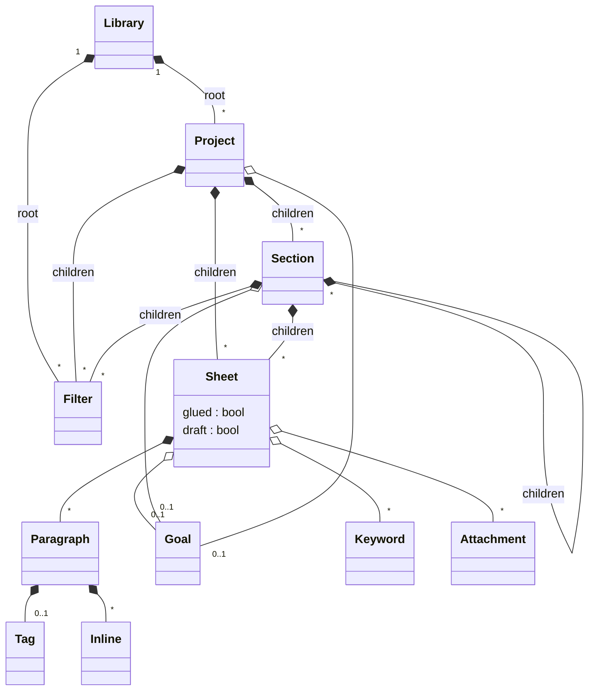
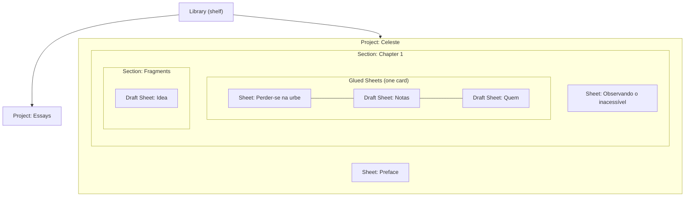
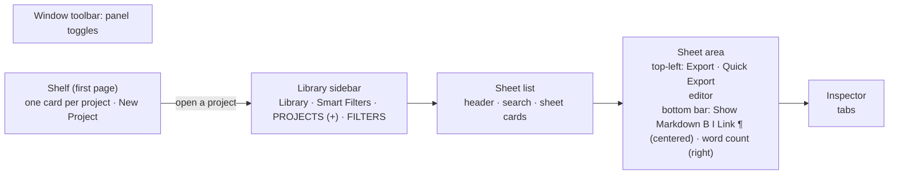
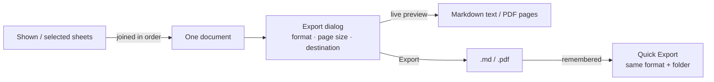

# Product concepts (terminology review)

## 1. Content model

| Placement rule | Where it's enforced |
|---|---|
| The library root holds only projects (and saved filters) | `AppState` (`check_placement`) |
| Every sheet and section lives inside a project, at any depth | same |
| Projects don't nest | same |
| Sheets/sections found at the root of an older library move into an "Unfiled" project on open | `AppState::adopt_loose_nodes` |
| A trashed sheet or section restores into a project, a project to the root | `AppState::restore_from_trash` |

| Term | Definition | Code name |
|---|---|---|
| Paragraph | One block of a sheet; separated by a blank line | `Paragraph` |
| Tag | Block type of a paragraph (heading, list, quote, code, comment, divider) | `TagKind` |
| Inline | Span inside a paragraph (strong, emph, link, code, footnote, image…) | `Inline` |
| Markdown XL | The plain-text markup sheets are written in | `parrot-markup` |
| Goal | Target count for a project, section or sheet: Simple or Daily, words or characters, optional deadline | `Goal` |
| Keyword | Tag assigned to a sheet | `Sheet::keywords` |
| Attachment | Note or file reference attached to a sheet | `Attachment` |
| Trash | Removed items, restorable | `AppState::trash` |

## 2. User-facing names

A sheet has three independent properties: **containment** (which project and section it is in), **glue** (which neighbouring sheets it opens with) and **classification** (draft or not). A sheet can have all three at once.

| UI name | What the user sees | Relationship | Code |
|---|---|---|---|
| Library | The shelf of projects (first page) and everything in the sidebar | Root | `Library` |
| Sidebar heading (PROJECTS, FILTERS) | Dimmed labels in the sidebar; "+" sits on PROJECTS | Display only, no data | `SidebarRow::Heading` |
| Project | A book on the shelf; top-level container under PROJECTS | Containment (root only) | `Node::Project` |
| Section | Folder inside a project; may nest | Containment | `Node::Group` |
| Sheet | One document; a row in the tree and a card in the sheet list | Leaf | `Node::Sheet` |
| Draft Sheet | Sheet designated as raw material, fragments, references, or working material | Classification / metadata | `Sheet::draft` |
| Glued Sheets | Consecutive sheets shown as one card; open together | Glue (siblings) | `Sheet::glued` run |
| Glue Sheets / Unglue Sheets | Menu commands that create/break glue | — | `glue_sheets` / `unglue_sheets` |
| Mark as Draft / Unmark as Draft | Context-menu commands that set/clear the draft mark | — | `set_draft` |
| Filter | Saved search in the tree | Query, contains nothing | `Node::Filter` |
| Smart Filter (All, Last 7 Days, Trash) | Fixed rows above the tree | Query | `SmartFilter` |
| Sheet Flow | Several sheets in one scrolling editor | View, no data | `sheet_flow` |

| Rule | Containment (Project, Section) | Glue (Glued Sheets) | Classification (Draft Sheet) |
|---|---|---|---|
| Applies to | Projects hold sections and sheets; sections hold sections and sheets | Sheets only | Sheets only |
| Scope | Projects at the root only; sections nest to any depth inside a project | Consecutive siblings in one parent; never crosses a section | Per sheet |
| Per sheet | Exactly one parent, always inside a project | At most one glued run | On or off |
| Shown as | Shelf card (project) / tree row with children | One card in the sheet list | Dashed-file badge on the row and card |
| Effect on opening | Lists its sheets | Opens all sheets of the run together | None |
| Moving a sheet | Changes parent; never to the root | Unglues it, unless its run-mates move with it | Kept |
| Trash / restore | Restores into a project | Unglues it | Kept |
| Stored as | Folder (`.ulproject`, `.ulgroup`) | `.glued` file in the parent folder | `.draft` file in the parent folder |

| Terminology to confirm | Proposed | Avoid |
|---|---|---|
| Single document | Sheet | Note (no "notes" concept) |
| Folder inside a project | Section | Group, Folder |
| Linked sheets that open together | Glued Sheets | Sheet group (clashes with Section) |
| Dimmed sidebar labels | Sidebar heading | Section (now means a folder) |
| Working material | Draft Sheet | Note, Scrap |

## 3. Window layout

| Area | Shows | Selection drives |
|---|---|---|
| Shelf | Every project as a card (title, sheets, drafts, words, goal ring) and a New Project card; full width | Opens the project in the sidebar and sheet list |
| Library sidebar | Library (back to the shelf), Smart Filters, then projects under PROJECTS and root filters under FILTERS | Sheet list |
| Smart Filter | All · Last 7 Days · Trash | Sheet list |
| Sheet list | Sheets of the selected project or section; glued sheets as one card | Sheet area |
| Sheet area | One sheet, or a sheet flow | Inspector |
| Sheet Flow | Several sheets stacked in one scrolling editor | — |
| Inspector | Tabs about the shown sheets | — |

| Project management | Where |
|---|---|
| New Project | Shelf card, "+" on PROJECTS, File menu |
| Rename, Duplicate, Move to Trash, Add Goal, Get Info | Right-click a shelf card or the project's tree row |
| New Section / New Sheet / New Filter | "+" on PROJECTS (into the current project), project or section context menu, Sheet menu, Ctrl+N (sheet) |

## 4. Inspector tabs

| Tab | Content |
|---|---|
| Statistics & Goals | Characters, words, reading time · goal ring and goal form · sessions |
| Keywords | Sheet keywords, Keyword Manager |
| Outline | Headings, click to jump |
| Links | Links in the text |
| Media | Images, videos, attachments |
| Character Counter | Counts, readability, platform limits, frequency |
| Spelling & Grammar | Combined findings for all shown sheets |

## 5. Writing aids

| Term | Definition |
|---|---|
| Show Markdown | Off (default): formatted text, markers hidden. On: Markdown markers visible, dimmed |
| Focus mode | Dims all but the current paragraph / sheet |
| Style | Editor stylesheet (ULSS), e.g. Default, Compact |
| Session | Manual writing-session counter for statistics |
| Text checking | Spelling (orange) and grammar (blue) underlines |

## 6. Export & import

| Term | Definition |
|---|---|
| Export | Writes the shown sheets as one file: Markdown or PDF |
| Quick Export | Repeats the last export's format and folder |
| Preview | Exact Markdown text, or the PDF's own pages to scale |
| Import | Adds sheets from Markdown, plain text, HTML, RTF, DOCX, ENEX or TextBundle files |

## 7. On disk

| Item | Stored as |
|---|---|
| Library | Folder |
| Project / Section | `*.ulproject` / `*.ulgroup` folder |
| Sheet | `*.parrot` folder with `Content.xml`, `Text.txt`, `Attachments.txt` |
| Order of children | `.order` file per folder |
| Glued Sheets | `.glued` file per folder |
| Draft Sheets | `.draft` file per folder |
| Last library | `last-library.txt` in the app config folder |
