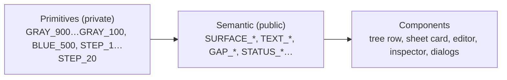

# Design tokens — proposal v2 (for review)

Status: **awaiting approval**. Nothing below is implemented yet.

## Principles

| # | Rule |
|---|---|
| P1 | Tokens are **semantic**: named for a role or intent (surface, text, gap, status), never for a component (no `SHEET_ROW_*`, `GOAL_*`, `DIALOG_*`). |
| P2 | Two tiers. **Primitives** (raw scale: gray ramp, blue, 4px steps) are private to `tokens.rs`. **Semantic** tokens are public and are the only tokens UI code may use. |
| P3 | A component picks the semantic token that matches its role. If no role fits, a new semantic role is added, not a component token. |
| P4 | Stock egui widgets get their styling from semantic tokens through `apply_visuals`. |
| P5 | Enforced by a check: no color or numeric literal in UI drawing calls outside `tokens.rs`. |

## 1. Color

| Semantic token | Role | Primitive | Replaces today |
|---|---|---|---|
| `SURFACE_CANVAS` | Writing surface, deepest layer | `#1a1a1a` | `BG_DEEP` |
| `SURFACE_BASE` | Default pane background | `#1e1e1e` | `BG_PANEL` |
| `SURFACE_RAISED` | Content sitting on a pane (cards, list) | `#252525` | `BG_MID` |
| `SURFACE_OVERLAY` | Floating layers (menus, windows, pills) | `#2e2e2e` | `BG_ELEVATED` |
| `SURFACE_SUNKEN` | Inputs, wells | `#222222` | `SURFACE_INSET` |
| `SURFACE_PAPER` / `SURFACE_PAPER_DARK` | Printed-page simulation | `#ffffff` / `#1a1a1a` | `PAGE_LIGHT` / `BG_DEEP` |
| `TEXT_PRIMARY` | Titles, emphasis | `#f0f0f0` | same |
| `TEXT_DEFAULT` | Body text, labels | `#d0d0d0` | `TEXT_SECONDARY` |
| `TEXT_LEAD` | Lead paragraph after a heading | `#c0c0c0` | `TEXT_SUBTITLE` |
| `TEXT_CODE` | Code text | `#a0a0a0` | `TEXT_CODE_BLOCK` |
| `TEXT_MUTED` | Secondary info, captions | `#888888` | `TEXT_TERTIARY` |
| `TEXT_SUBTLE` | Hints, section labels, markup markers | `#555555` | `TEXT_QUATERNARY` |
| `TEXT_DISABLED` | Disabled content | `#444444` | same |
| `TEXT_ON_PAPER` | Ink on `SURFACE_PAPER` | `#202020` | `PAGE_LIGHT_TEXT` |
| `ACCENT` | Primary action, active selection | `#3478f6` | same |
| `ACCENT_SUBTLE` | Secondary selection (context of the active item) | `#263a5c` | `ACCENT_MUTED` |
| `LINK` | Hyperlinks | `#5ab0f6` | `ACCENT_LIGHT` |
| `BORDER_SUBTLE` | Dividers, outlines | `#333333` | `DIVIDER` |
| `STATUS_NEUTRAL` | Not started / track | `#555555` | `GOAL_INCOMPLETE` |
| `STATUS_SUCCESS` | Done, reached | `#4caf50` | `GOAL_COMPLETE` |
| `STATUS_WARNING` | Needs attention | `#f0a500` | `GOAL_ALMOST`, `SPELLING` (`#f5a623`, merged) |
| `STATUS_INFO` | Suggestion | `#5ab0f6` | `GRAMMAR` |
| `STATUS_ERROR` | Failure | `#e04b4b` | `ERROR` |

## 2. Typography

| Semantic token | Role | Size / weight | Replaces today |
|---|---|---|---|
| `PROSE_HEADING_1…6` | Document headings | 28/22/18/16/15/14 bold | `HEADING_1…6` |
| `PROSE` | Document body text | 15 | `BODY` |
| `PROSE_CODE` / `PROSE_CODE_SMALL` | Inline code / code blocks | 13 / 12 mono | `MONO` / `MONO_BLOCK` |
| `TITLE` | Pane or view title | 14 bold | `UI_HEADER` |
| `LABEL` / `LABEL_STRONG` | Control and list text | 13 / 13 bold | `UI_LABEL` / `UI_LABEL_STRONG` |
| `CAPTION` | Metadata, status, hints | 11 | `UI_CAPTION` |
| `OVERLINE` | Section labels (uppercase) | 11 bold | `UI_SECTION` |
| `LEADING_PROSE` | Line height ratio for prose | 1.4 | `font_size * 1.4` in `render.rs` |

## 3. Spacing

| Semantic token | Role | Value | Replaces (examples) |
|---|---|---|---|
| `GAP_TIGHT` | Between tightly related items (icon–label, chip row) | 4 | `GRID`, grid row gap `4.0` |
| `GAP_DEFAULT` | Between items in a group | 8 | `2.0 * GRID` |
| `GAP_GROUP` | Between groups in a pane | 12 | `3.0 * GRID` |
| `GAP_SECTION` | Between sections | 16 | `4.0 * GRID`, grid column gap `16.0` |
| `GAP_BLOCK` | Between major blocks (sheets in a flow) | 24 | `6.0 * GRID` |
| `GAP_HERO` | Empty-state / page top offset | 80 | `20.0 * GRID`, shelf margin `10.0 * GRID` |
| `INSET_CONTROL` | Padding inside controls | (8, 4) | button/toolbar margins |
| `INSET_CONTAINER` | Padding inside panes and bars | (12, 8) | `PANEL_PADDING_X/Y`, status bar margin |
| `INSET_SURFACE` | Padding inside page-like surfaces | 16 | preview page margin |
| `INDENT_LEVEL` | One hierarchy level | 16 | `INDENT` |
| `INDENT_BLOCK` | Quote / list block indent | 24 | `render.rs` `INDENT` |

## 4. Size

| Semantic token | Role | Value | Replaces today |
|---|---|---|---|
| `ICON_SM` / `ICON_MD` / `ICON_LG` | Icon glyph sizes | 11 / 15 / 16 | toolbar `15.0`, `INSPECTOR_ICON_SIZE`, `icons.rs` `14.0` |
| `CONTROL_HEIGHT` | Single-line control or list item | 22 | `TREE_ROW_HEIGHT` |
| `CONTROL_HEIGHT_LG` | Prominent control, bar | 28 | `7.0 * GRID` (pill strip, Export button) |
| `ITEM_HEIGHT_RICH` | Multi-line list item (title + preview) | 88 | `SHEET_ROW_HEIGHT` |
| `ITEM_SIZE_COVER` | Portrait, cover-like grid item | 168×216 | `SHELF_CARD` |
| `ACCENT_EDGE_WIDTH` | Accent stripe on an item's leading edge | 8 | shelf card spine `2.0 * GRID` |
| `INDICATOR_SM` / `INDICATOR_LG` | Progress indicator diameter | 14 / 62 | `GOAL_RING_DIAMETER`, inspector ring `31.0` |
| `DOT` | Status dot diameter | 6 | error dot `3.0` radius |
| `FIELD_WIDTH_SM` | Short numeric field | 56 | counter limit field |
| `VIZ_HEIGHT_SM` / `VIZ_BAR_MAX` | Small chart height / bar width cap | 60 / 16 | statistics chart |

## 5. Layout

| Semantic token | Role | Value | Replaces today |
|---|---|---|---|
| `MEASURE_PROSE` / `MEASURE_MIN` | Max / min prose line length | 640 / 200 | `TEXT_COLUMN_MAX_WIDTH`, `MIN_COLUMN_WIDTH` |
| `GUTTER_PROSE` | Side margin around prose | 80 | `SIDE_MARGIN` |
| `GUTTER_PROSE_Y` | Vertical padding around prose | 40 | `COLUMN_PADDING_Y` |
| `MARGIN_NOTE_OFFSET` | Margin annotations (paragraph numbers) | 40 | `PARAGRAPH_NUMBER_OFFSET` |
| `PANE_WIDTH_SM` / `_MD` / `_LG` | Side pane widths (resizable 0.75×–2×) | 160 / 220 / 280 | `LIBRARY_WIDTH`, `INSPECTOR_WIDTH`, `SHEET_LIST_WIDTH` |
| `OVERLAY_WIDTH_SM` / `_LG` | Side column / content column of an overlay | 220 / 360 | export options / preview widths |
| `OVERLAY_HEIGHT_MAX` | Max scroll height inside an overlay | 460 | export preview height |
| `VIEWPORT_DEFAULT` / `VIEWPORT_MIN` | Window size | 1400×860 / 960×560 | `main.rs` |

## 6. Shape, stroke, opacity

| Semantic token | Role | Value | Replaces today |
|---|---|---|---|
| `RADIUS_CONTROL` | Controls, selections, cards | 4 | `SELECTION_RADIUS` |
| `RADIUS_PILL` | Fully rounded badges | 10 | `BADGE_RADIUS` |
| `RADIUS_SUBTLE` | Small data marks | 1 | chart bars |
| `BORDER_WIDTH` | Dividers, outlines, underlines | 1 | `Stroke::new(1.0, …)` |
| `STROKE_INDICATOR` / `STROKE_INDICATOR_LG` | Progress track and arc | 2 / 4 | ring `1.5`, `2.0`, `4.0` |
| `STROKE_FOCUS` | Drop and focus indicators | 2 | drop indicator `2.0` |
| `OPACITY_DIMMED` | De-emphasised content | 0.55 | `FADED_ALPHA` |

## 7. Stock widgets (`apply_visuals`)

| egui style field | Semantic token |
|---|---|
| `TextStyle::Body` / `Button` | `LABEL` |
| `TextStyle::Small` | `CAPTION` |
| `TextStyle::Heading` | `TITLE` |
| `TextStyle::Monospace` | `PROSE_CODE` |
| `spacing.item_spacing` | (`GAP_DEFAULT`, `GAP_TIGHT`) |
| `spacing.button_padding` | `INSET_CONTROL` |
| `spacing.window_margin` | `INSET_CONTAINER` |
| `window_rounding`, `menu_rounding`, widget rounding | `RADIUS_CONTROL` |
| `panel_fill` / `window_fill` / `extreme_bg_color` | `SURFACE_BASE` / `SURFACE_OVERLAY` / `SURFACE_SUNKEN` |
| `selection.bg_fill` / `hyperlink_color` | `ACCENT` / `LINK` |

## 8. Enforcement

| Check | Scope |
|---|---|
| `check_no_hardcoded_colors.sh` (exists) | Color literals outside `tokens.rs` |
| `check_no_hardcoded_metrics.sh` (new, in `check.sh`) | Float literals in `add_space`, `vec2`, `Margin::*`, `Stroke::new`, `Rounding`, `.size(`, `.width(`, `.spacing(` outside `tokens.rs` |
| `tokens.rs` unit test | Primitives stay private (semantic tokens are the only `pub` items) |
| Exempt | Tests, `text_shaping_spike.rs`, centering math (0.0, 0.5, 1.0, 2.0 divisors) |

## Decisions needed

| # | Question | Default if no answer |
|---|---|---|
| Q1 | Merge spelling orange `#f5a623` into `STATUS_WARNING` `#f0a500`? | merge |
| Q2 | Grammar and links share `#5ab0f6` — keep as two tokens (`STATUS_INFO`, `LINK`) on one primitive? | two tokens, one primitive |
| Q3 | Export PDF backend sizes (pt, mm) are print units, not UI — keep them in `parrot-export`, outside the UI token set? | keep in `parrot-export` |
